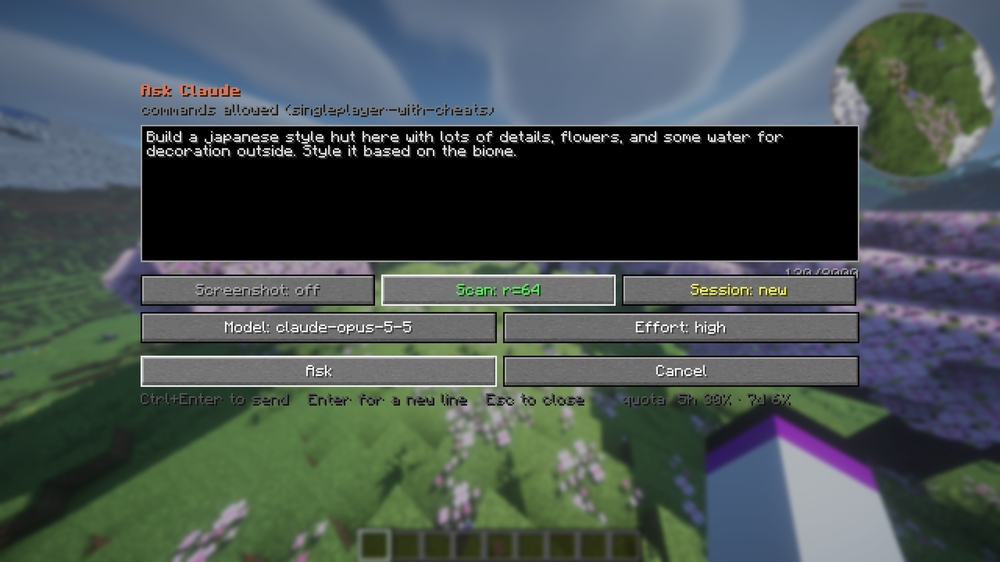
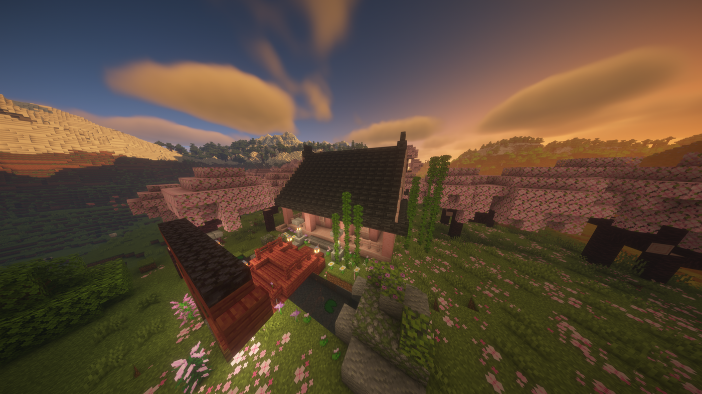
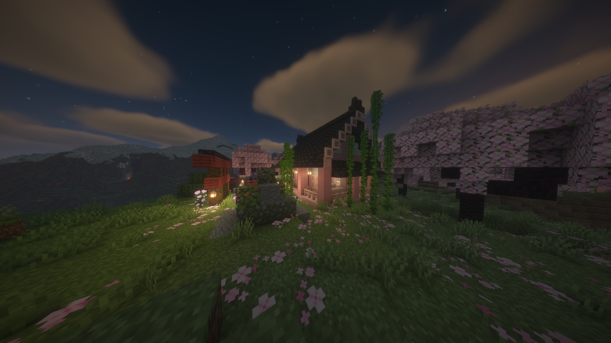
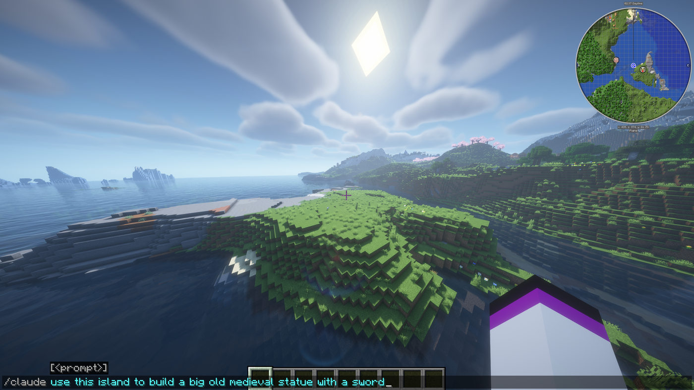
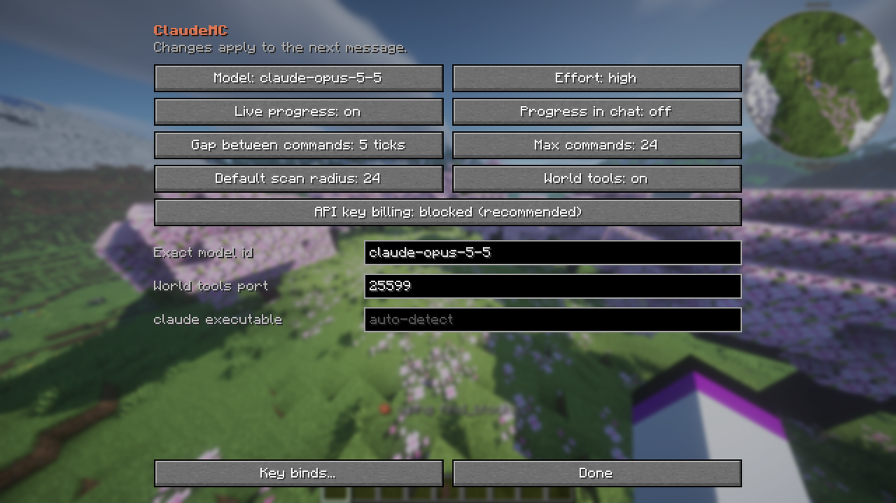

<div align="center">


# ClaudeMC

**Run your own Claude Code from inside Minecraft.**

Ask a question in chat, get an answer in chat, and run the commands it proposes with a click.

[](https://www.minecraft.net/)
[](https://fabricmc.net/)
[](https://adoptium.net/)
[](LICENSE)

> **NOT AN OFFICIAL MINECRAFT PRODUCT. NOT APPROVED BY OR ASSOCIATED WITH MOJANG OR MICROSOFT.**
> Not made, endorsed or supported by Anthropic. Claude and Claude Code are trademarks of Anthropic.

</div>

---

## Overview

ClaudeMC is a client-side Fabric mod that connects Minecraft to the **Claude Code CLI already
installed on your machine**. It sends Claude your question along with live context about where
you are standing and what is around you, then turns the reply into commands you can review and
run without leaving the game.

The mod is free and bundles no Anthropic code or credentials. It launches the `claude` program
you installed as a subprocess, so usage runs through your own Anthropic account, under your own
agreement with Anthropic. See [Your Anthropic account](#your-anthropic-account) and
[What leaves your computer](#what-leaves-your-computer) before you start. The conversation stays
alive between prompts and across restarts.

## From one prompt to a finished build

Describe what you want. The prompt screen takes multi-line text, and can attach a screenshot or
a scan of the surrounding blocks so the answer fits the place you are standing in.



That prompt, with a 64-block scan attached, produced this:





Nothing about the biome, the palette or the terrain was specified beyond "style it based on the
biome" — the scan is what made that possible.

## Requirements

| | |
|---|---|
| Minecraft | 1.21.11 |
| Loader | [Fabric](https://fabricmc.net/use/) + [Fabric API](https://modrinth.com/mod/fabric-api) |
| Java | 21 or newer |
| CLI | [Claude Code](https://claude.com/claude-code), signed in — `claude --version` must work |
| Optional | WorldEdit (strongly recommended), [Mod Menu](https://modrinth.com/mod/modmenu) for the settings button |

## Install

1. Install Claude Code and sign in.
2. Install Fabric Loader for 1.21.11 and Fabric API.
3. Download `claudemc-*.jar` from [Releases](../../releases) and place it in your `mods` folder.
4. Launch the game, join a world, and run `/claude hello`.

## Usage

Press <kbd>H</kbd> for the prompt screen, or type a command in chat:

| Command | Description |
|---|---|
| `/claude <prompt>` | Ask, continuing the current session |
| `/claude new <prompt>` | Start a fresh session |
| `/claude shot <prompt>` | Attach your most recent screenshot (press <kbd>F2</kbd> first) |
| `/claude scan <r> <prompt>` | Attach a block scan of radius `r` (1–256) |
| `/claude shot scan <r> <prompt>` | Attach both; either order works |
| `/claude open` | Open the prompt screen |
| `/claude last` | Reopen the approval menu |
| `/claude undo` | Queue `//undo` |
| `/claude cancel` | Discard anything queued and abort the request in flight |
| `/claude model <id>` | Switch model — an alias or an exact id |
| `/claude effort <level>` | `low`, `medium`, `high`, or `default` |
| `/claude settings` | Open the settings screen |
| `/claude keys` | Show bindings and conflicts, and rebind |
| `/claude usage` | Quota windows and this session's token use |
| `/claude notes` | Path to the current world's notes file |
| `/claude status` | Session, model, permissions, and billing source |

`/ai` is accepted as a shorthand for all of the above.

### Reviewing commands

Proposed commands arrive in chat as clickable `[Run]` and `[Copy]` entries, with `[Run all]`
and a paged approval menu alongside. The menu renders each command as an editable field, so a
radius or a block can be adjusted before it is sent. Commands are queued a few ticks apart to
stay clear of server chat-rate limits.

### Context

Every prompt is accompanied by a freshly written snapshot of your position, facing, dimension,
biome, light level, the block you are looking at, and your installed mods, so answers do not
depend on you describing your surroundings.

Scans extend to a 256-block radius. Air is never written: each layer is emitted as run-length
spans of non-air blocks with exact coordinates, and anything absent is air.

### Notes

Claude maintains a notes file per world — `notes/<world>.md` in the mod's working directory —
holding coordinates, palettes, and decisions. Singleplayer worlds are keyed by level name and
servers by address, so work on one never appears in another.

## Asking in chat, and watching the commands run

The prompt screen is convenient, not required. A `/claude` line in chat does the same job, and
the chat input stretches past vanilla's 256-character limit while you are typing one:



Claude does not edit the world behind your back. Every command it issues is printed in chat as
it goes out, in order, under your own name — so a build is something you watch happen rather
than a diff you discover afterwards.

Claude selects with `//pos1` and `//pos2`, fills with
`//set stone_bricks`, carves back with `//set air`, and says when it is done. Each line is a
command you could have typed yourself.

When commands are proposed rather than run directly — outside creative, or whenever you prefer
to approve them — they arrive as clickable `[Run]` entries instead. See
[Reviewing commands](#reviewing-commands).

## Settings



Reachable from `/claude settings`, or from the cog beside ClaudeMC in Mod Menu. All options
apply to the next message; nothing requires editing files.

### Mod Menu

[Mod Menu](https://modrinth.com/mod/modmenu) collects every installed mod's settings behind one
tab, and ClaudeMC registers itself there so it lives alongside the rest rather than hiding
behind a chat command.

It is entirely optional. The integration is compiled against the Mod Menu API but not bundled
with it, so the mod loads normally whether or not Mod Menu is present, and the settings screen
is built from plain vanilla widgets — no configuration library is pulled in either way.

### Keybinds

Rebindable under **Options → Controls → Key Binds → ClaudeMC**, or via the **Key binds…**
button in the settings screen.

| Default | Action |
|---|---|
| <kbd>H</kbd> | Open the prompt screen |
| <kbd>U</kbd> | Reopen the last proposal |
| *unbound* | Undo last WorldEdit |

Defaults are chosen to avoid both vanilla and common build mods. Because that can only ever be
true of one particular mod list, ClaudeMC checks its bindings against every installed mod when
you join a world and reports any clash in chat with a rebinding link. `/claude keys` runs the
same check on demand.

## Safety

Every command ClaudeMC runs is sent as an ordinary chat command under your own name and your
own permissions. There is no elevation and no server-side component; nothing can be done that
you could not have typed yourself.

- **Permission is checked before Claude is asked.** The mod inspects the command tree the
  server sent you. A world without cheats provides a minimal tree, so ClaudeMC knows it is
  read-only, instructs Claude not to propose commands, and answers with advice.
- **Nothing runs unprompted.** Commands enter the queue only when you click, except for direct
  world tools, which additionally require creative mode.
- **Deny list.** `/op`, `/ban`, `/kick`, `/whitelist`, `/stop` and similar are refused in the
  queue regardless of what is returned. Configurable.
- **Singleplayer survival** can be enabled the usual way: pause → **Open to LAN** →
  *Allow Cheats: ON* → **Start LAN World**.

**Block reads can see hidden blocks.** Scans and the read-only world tools see every block your
client has loaded, including buried ones such as ores, and they are not limited by game mode or
server. On a server this can work like X-ray, which many servers forbid. Follow the rules of the
server you are on, and do not use scans or these tools where that is not allowed.

## What leaves your computer

This mod starts the Claude Code CLI you installed, and that program sends data to Anthropic under
your own account and Anthropic's terms. The mod's author receives nothing.

When you send a prompt, Claude can receive:

- your prompt and the replies in that session
- your position and facing, dimension, biome, light level, time of day, game mode, held item and
  the block you are looking at
- the world name, or the server's name and address
- your installed mod list
- block scans and screenshots, if you attach them or Claude requests a scan with the world tools
- your per-world notes file

A screenshot shows whatever was on screen, which can include chat and other players' names. How
long Anthropic keeps this data, and whether it trains models on it, depends on your account type
and settings: see [Anthropic's data usage page](https://code.claude.com/docs/en/data-usage).
Claude Code also keeps local session transcripts of its own.

On your machine:

- The mod writes context, scans, copied screenshots and notes to `<gameDir>/claudemc/`.
- It runs a local server on `127.0.0.1` (port 25599 by default) so Claude Code can talk to the
  game. The server accepts no outside connections. Turn it off with `bridgeEnabled`, or
  **World tools** in the settings; Claude then loses the direct world tools.

## Your Anthropic account

You need your own Claude Code install, signed in to your own account. The mod does not read,
store or relay your credentials.

**Check Anthropic's terms yourself.** Anthropic's
[legal and compliance page](https://code.claude.com/docs/en/legal-and-compliance) tells developers
building products to use API keys, and restricts routing requests through Free, Pro, Max or Ultra
plan credentials. It also says end users can sign in to the unmodified Claude Code binary with
their own subscription. Anthropic has not reviewed this mod or confirmed that running it on a plan
login is allowed, and it can enforce its rules without notice. An API key is the clearly supported
route, but it is billed per token. Which you use, and any effect on your account, is your
responsibility.

### Billing

ClaudeMC bills however your `claude` CLI is authenticated. The CLI's credential order places
`ANTHROPIC_API_KEY` above a claude.ai login, so a key set for an unrelated project would
otherwise turn every prompt into a per-token charge.

API key billing is therefore **disabled by default**, to prevent surprise charges: the credential
variables are removed from the environment handed to the CLI, which falls back to your
subscription login if you have one. If a key was present and ignored, the mod says so once.

It can be enabled in **Settings → API key billing**. While enabled, every reply, the action bar
and `/claude status` carry a warning glyph naming the credential that was charged.

## World tools

Each session is given an MCP server pointing back at the running client:

| Tool | Description |
|---|---|
| `get_context` | Position, facing, biome, look target, installed mods, `can_build` |
| `get_block` | One coordinate, with full block state |
| `scan_area` | Cylinder scan to radius 256, as run-length spans of non-air blocks |
| `find_blocks` | Where a block type occurs nearby, with a bounding box |
| `run_command`, `run_commands` | Execute commands — creative and command permission only |
| `say` | Write a line to the player's chat |

Reads are always available, including on servers and outside creative (see
[Safety](#safety)). Writes are refused outside creative, refused without command
permission, filtered by the deny list, paced by the queue, and interruptible with
`/claude cancel`. Refusals explain themselves, so Claude falls back to proposing commands for
manual approval rather than retrying.

## Configuration

`config/claudemc.json` is created on first launch:

```jsonc
{
  "claudePath": "",            // empty = auto-detect
  "model": "opus",             // alias or exact id
  "effort": "",                // low | medium | high
  "timeoutSeconds": 240,
  "streaming": true,           // show progress while the reply arrives
  "commandDelayTicks": 5,      // gap between queued commands
  "chatPromptLimit": 2000,     // chat input cap while typing a /claude line
  "allowApiKey": false,        // see Billing
  "bridgeEnabled": true,
  "bridgePort": 25599,
  "defaultScanRadius": 24,
  "maxCommands": 24,
  "blockedPrefixes": ["/stop", "/op", "/deop", "/ban", "/kick", "/whitelist"]
}
```

## Architecture

```
  Minecraft client
        │  /claude <prompt>
        ▼
  ┌───────────┐    writes    ┌──────────────────────────┐
  │  ClaudeMC │ ───────────► │  <gameDir>/claudemc/     │
  │    mod    │              │    CLAUDE.md             │
  └─────┬─────┘              │    context.json          │
        │ spawns             │    notes/<world>.md      │
        │                    │    shots/  scans/        │
        ▼                    └──────────────────────────┘
  claude -p --output-format stream-json --resume <session>
        │                              ▲
        │  {"summary":…,"commands":[…]} │ reads
        ▼                              │
  approval menu ──► click ──► queue ──► chat, as the player
```

`CLAUDE.md` is auto-discovered by Claude Code at session start, so a new session knows it is
driving a Minecraft client before reading the first prompt.

### Bridge

A loopback-only HTTP server (default `127.0.0.1:25599`) lets a Claude Code session you started
yourself read game state and push proposals into the approval menu. The token is written to
`claudemc/bridge.json`.

```bash
curl -s -H "X-ClaudeMC-Token: $TOKEN" http://127.0.0.1:25599/context

curl -s -X POST -H "X-ClaudeMC-Token: $TOKEN" \
  -d '{"summary":"example","commands":[{"cmd":"//limit -1","note":"lift the block cap"}]}' \
  http://127.0.0.1:25599/propose
```

## Building

```bash
git clone https://github.com/omeldar/claude-mc.git
cd claude-mc
./gradlew build              # jar is written to build/libs/
python tools/make_icons.py   # regenerate the font sheet and mod icon
```

Gradle provisions a matching JDK automatically. Note that Fabric Loom requires a Java 25 JVM to
*run* Gradle, while the mod itself targets Java 21.

## Roadmap

- Render proposals as a HUD list without opening a screen
- Litematica schematic generation from a description

## License

MIT — see [LICENSE](LICENSE).

NOT AN OFFICIAL MINECRAFT PRODUCT. NOT APPROVED BY OR ASSOCIATED WITH MOJANG OR MICROSOFT.
Not made, endorsed or supported by Anthropic. Claude and Claude Code are trademarks of Anthropic.

This project is published and maintained by [omeldar](https://github.com/omeldar), who alone is
responsible for it. Contact: [GitHub Issues](https://github.com/omeldar/claude-mc/issues).
