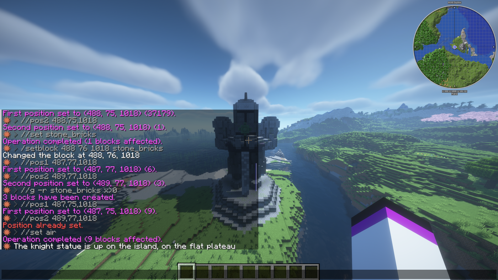
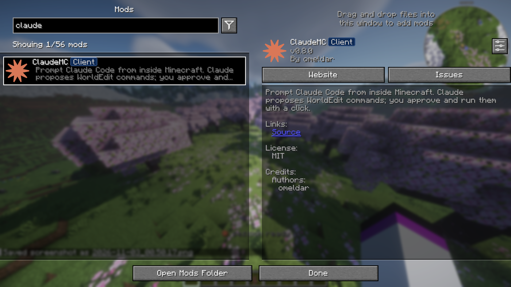

<div align="center">


# ClaudeMC

**Claude Code, inside Minecraft.**

Ask a question in chat, get an answer in chat, and run the commands it proposes with a click.

[](https://www.minecraft.net/)
[](https://fabricmc.net/)
[](https://adoptium.net/)
[](LICENSE)

</div>

---

## Overview

ClaudeMC is a client-side Fabric mod that connects Minecraft to the **Claude Code CLI already
installed on your machine**. It sends Claude your question along with live context about where
you are standing and what is around you, then turns the reply into commands you can review and
run without leaving the game.

The mod requires no API key and adds no cost of its own. It launches `claude` as a subprocess,
so it authenticates exactly as your terminal does, and it keeps the conversation alive between
prompts and across restarts.

## How it works

**1 — Describe what you want.** The prompt screen takes multi-line text and lets you attach a
screenshot or a scan of the surrounding blocks. Model and effort are switchable per prompt.


**2 — Claude reads the world and builds.** With command permission in creative, Claude can call
world tools directly: reading blocks, scanning regions, and issuing WorldEdit or vanilla
commands. Every command appears in chat as it runs, under your own name.



**3 — The result.**


Outside creative, or anywhere you lack command permission, Claude is told not to propose
commands at all and answers with advice instead. See [Safety](#safety).

## Requirements

| | |
|---|---|
| Minecraft | 1.21.11 |
| Loader | [Fabric](https://fabricmc.net/use/) + [Fabric API](https://modrinth.com/mod/fabric-api) |
| Java | 21 or newer |
| CLI | [Claude Code](https://claude.com/claude-code), signed in — `claude --version` must work |
| Optional | WorldEdit (strongly recommended), [Mod Menu](https://modrinth.com/mod/modmenu) for the settings button |

## Install

1. Install Claude Code and sign in.
2. Install Fabric Loader for 1.21.11 and Fabric API.
3. Download `claudemc-*.jar` from [Releases](../../releases) and place it in your `mods` folder.
4. Launch the game, join a world, and run `/claude hello`.

## Usage

Press <kbd>H</kbd> for the prompt screen, or type a command in chat:

| Command | Description |
|---|---|
| `/claude <prompt>` | Ask, continuing the current session |
| `/claude new <prompt>` | Start a fresh session |
| `/claude shot <prompt>` | Attach your most recent screenshot (press <kbd>F2</kbd> first) |
| `/claude scan <r> <prompt>` | Attach a block scan of radius `r` (1–256) |
| `/claude shot scan <r> <prompt>` | Attach both; either order works |
| `/claude open` | Open the prompt screen |
| `/claude last` | Reopen the approval menu |
| `/claude undo` | Queue `//undo` |
| `/claude cancel` | Discard anything queued and abort the request in flight |
| `/claude model <id>` | Switch model — an alias or an exact id |
| `/claude effort <level>` | `low`, `medium`, `high`, or `default` |
| `/claude settings` | Open the settings screen |
| `/claude keys` | Show bindings and conflicts, and rebind |
| `/claude usage` | Quota windows and this session's token use |
| `/claude notes` | Path to the current world's notes file |
| `/claude status` | Session, model, permissions, and billing source |

`/ai` is accepted as a shorthand for all of the above.

### Reviewing commands

Proposed commands arrive in chat as clickable `[Run]` and `[Copy]` entries, with `[Run all]`
and a paged approval menu alongside. The menu renders each command as an editable field, so a
radius or a block can be adjusted before it is sent. Commands are queued a few ticks apart to
stay clear of server chat-rate limits.

### Context

Every prompt is accompanied by a freshly written snapshot of your position, facing, dimension,
biome, light level, the block you are looking at, and which build mods are installed, so
answers do not depend on you describing your surroundings.

Scans extend to a 256-block radius. Air is never written: each layer is emitted as run-length
spans of non-air blocks with exact coordinates, and anything absent is air.

### Notes

Claude maintains a notes file per world — `notes/<world>.md` in the mod's working directory —
holding coordinates, palettes, and decisions. Singleplayer worlds are keyed by level name and
servers by address, so work on one never appears in another.

## Settings


Reachable from `/claude settings` or the cog beside ClaudeMC in Mod Menu. All options apply to
the next message; nothing requires editing files.



### Keybinds

Rebindable under **Options → Controls → Key Binds → ClaudeMC**, or via the **Key binds…**
button in the settings screen.

| Default | Action |
|---|---|
| <kbd>H</kbd> | Open the prompt screen |
| <kbd>U</kbd> | Reopen the last proposal |
| *unbound* | Undo last WorldEdit |

Defaults are chosen to avoid both vanilla and common build mods. Because that can only ever be
true of one particular mod list, ClaudeMC checks its bindings against every installed mod when
you join a world and reports any clash in chat with a rebinding link. `/claude keys` runs the
same check on demand.

## Safety

Every command ClaudeMC runs is sent as an ordinary chat command under your own name and your
own permissions. There is no elevation and no server-side component; nothing can be done that
you could not have typed yourself.

- **Permission is checked before Claude is asked.** The mod inspects the command tree the
  server sent you. A world without cheats provides a minimal tree, so ClaudeMC knows it is
  read-only, instructs Claude not to propose commands, and answers with advice.
- **Nothing runs unprompted.** Commands enter the queue only when you click, except for direct
  world tools, which additionally require creative mode.
- **Deny list.** `/op`, `/ban`, `/kick`, `/whitelist`, `/stop` and similar are refused in the
  queue regardless of what is returned. Configurable.
- **Singleplayer survival** can be enabled the usual way: pause → **Open to LAN** →
  *Allow Cheats: ON* → **Start LAN World**.

### Billing

ClaudeMC bills however your `claude` CLI is authenticated. The CLI's credential order places
`ANTHROPIC_API_KEY` above a claude.ai login, so a key set for an unrelated project would
otherwise turn every prompt into a per-token charge.

API key billing is therefore **disabled by default and enforced**: the credential variables are
removed from the environment handed to the CLI, which falls back to your subscription. If a key
was present and ignored, the mod says so once.

It can be enabled in **Settings → API key billing**. While enabled, every reply, the action bar
and `/claude status` carry a warning glyph naming the credential that was charged.

## World tools

Each session is given an MCP server pointing back at the running client:

| Tool | Description |
|---|---|
| `get_context` | Position, facing, biome, look target, installed mods, `can_build` |
| `get_block` | One coordinate, with full block state |
| `scan_area` | Cylinder scan to radius 256, as run-length spans of non-air blocks |
| `find_blocks` | Where a block type occurs nearby, with a bounding box |
| `run_command`, `run_commands` | Execute commands — creative and command permission only |
| `say` | Write a line to the player's chat |

Reads are always available. Writes are refused outside creative, refused without command
permission, filtered by the deny list, paced by the queue, and interruptible with
`/claude cancel`. Refusals explain themselves, so Claude falls back to proposing commands for
manual approval rather than retrying.

## Configuration

`config/claudemc.json` is created on first launch:

```jsonc
{
  "claudePath": "",            // empty = auto-detect
  "model": "opus",             // alias or exact id
  "effort": "",                // low | medium | high
  "timeoutSeconds": 240,
  "streaming": true,           // show progress while the reply arrives
  "commandDelayTicks": 5,      // gap between queued commands
  "chatPromptLimit": 2000,     // chat input cap while typing a /claude line
  "allowApiKey": false,        // see Billing
  "bridgeEnabled": true,
  "bridgePort": 25599,
  "defaultScanRadius": 24,
  "maxCommands": 24,
  "blockedPrefixes": ["/stop", "/op", "/deop", "/ban", "/kick", "/whitelist"]
}
```

## Architecture

```
  Minecraft client
        │  /claude <prompt>
        ▼
  ┌───────────┐    writes    ┌──────────────────────────┐
  │  ClaudeMC │ ───────────► │  <gameDir>/claudemc/     │
  │    mod    │              │    CLAUDE.md             │
  └─────┬─────┘              │    context.json          │
        │ spawns             │    notes/<world>.md      │
        │                    │    shots/  scans/        │
        ▼                    └──────────────────────────┘
  claude -p --output-format stream-json --resume <session>
        │                              ▲
        │  {"summary":…,"commands":[…]} │ reads
        ▼                              │
  approval menu ──► click ──► queue ──► chat, as the player
```

`CLAUDE.md` is auto-discovered by Claude Code at session start, so a new session knows it is
driving a Minecraft client before reading the first prompt.

### Bridge

A loopback-only HTTP server (default `127.0.0.1:25599`) lets a Claude Code session you started
yourself read game state and push proposals into the approval menu. The token is written to
`claudemc/bridge.json`.

```bash
curl -s -H "X-ClaudeMC-Token: $TOKEN" http://127.0.0.1:25599/context

curl -s -X POST -H "X-ClaudeMC-Token: $TOKEN" \
  -d '{"summary":"example","commands":[{"cmd":"//limit -1","note":"lift the block cap"}]}' \
  http://127.0.0.1:25599/propose
```

## Building

```bash
git clone https://github.com/omeldar/claude-mc.git
cd claude-mc
./gradlew build              # jar is written to build/libs/
python tools/make_icons.py   # regenerate the font sheet and mod icon
```

Gradle provisions a matching JDK automatically. Note that Fabric Loom requires a Java 25 JVM to
*run* Gradle, while the mod itself targets Java 21.

## Roadmap

- Render proposals as a HUD list without opening a screen
- Litematica schematic generation from a description

## License

MIT — see [LICENSE](LICENSE).

Not affiliated with Mojang or Microsoft. Claude and Claude Code are products of Anthropic.
